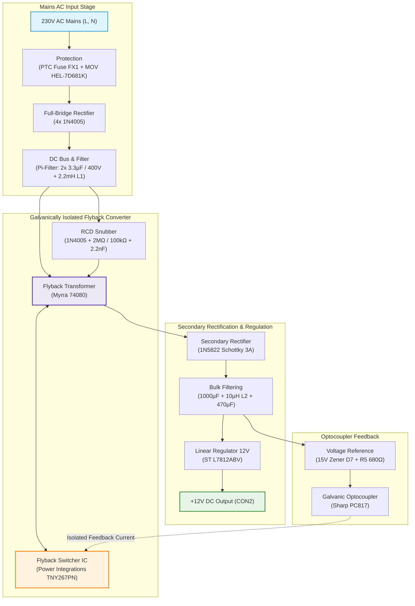
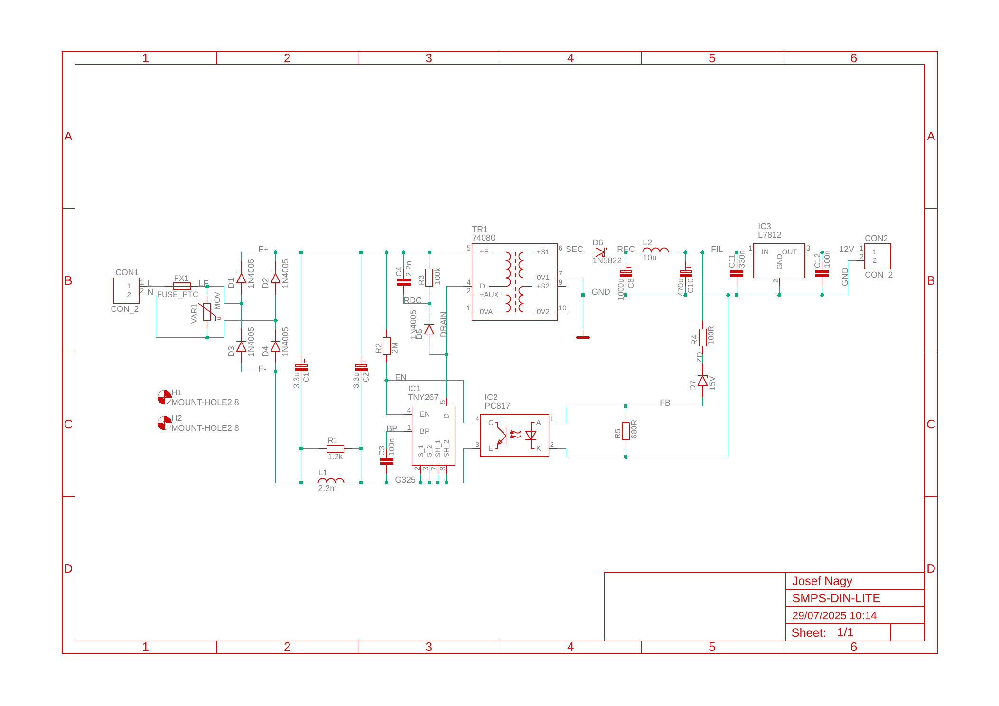

# DIN-Rail Switched-Mode Power Supply Lite (`din-smps-lite`)

> Ultra-compact, cost- and space-optimized offline flyback auxiliary power supply for 35 mm DIN-rail modular enclosures, delivering a regulated +12 V DC rail.

**Project Status:** `Completed / Production Ready` | **EDA Tool:** `Autodesk Eagle 9.x` | **Category:** `Power Electronics / Hardware`

---

## 1. Overview and Purpose

The `din-smps-lite` repository provides an ultra-compact, high-efficiency offline AC/DC switched-mode power supply designed for DIN-rail distribution enclosures and localized automation sub-racks. It serves as a streamlined, space-optimized alternative to the dual-output [din-smps](https://github.com/nagyjose/din-smps) main model.

By focusing on a single high-integrity **+12 V DC** regulated rail and utilizing standing component footprints, this design achieves a minimal PCB footprint while retaining full galvanic isolation (> 3 kV) and mains protection.

### Key Features
- **Galvanic Isolation:** High-voltage isolation exceeding 3 kV via an optocoupler feedback loop and specialized flyback transformer.
- **High Efficiency & Low Standby:** Powered by the **Power Integrations TNY267PN** TinySwitch-II offline switcher with EcoSmart® technology, providing auto-restart, cycle skipping, and thermal shutdown.
- **Input Protection:** AC mains surge suppression via a Metal Oxide Varistor (`VAR1`, 420V AC / 680V clamping) and overcurrent protection via a resettable PTC fuse (`FX1`).
- **Single Regulated +12 V DC Rail:** Regulated by an **STMicroelectronics L7812ABV** linear regulator with bulk electrolytic and ceramic decoupling for noise-free relay, actuator, and bus power.
- **Space-Saving Footprints:** Utilizes vertical/standing component geometries (`_STOJ`) for axial resistors to minimize overall PCB dimensions.
- **Ready for Manufacture:** Complete Autodesk Eagle schematic (`.sch`), 2-layer PCB layout (`.brd`), CAM drill configuration (`DRILEGEND.CFG`), and PDF drawings.

---

## 2. Technical Specifications

| Parameter | Specification (`SMPS-DIN-LITE`) |
| :--- | :--- |
| **Input Voltage Range** | 85 – 265 V AC, 50/60 Hz |
| **Input Connector** | 2-position 5.00 mm screw terminal (`CON1`: Line, Neutral) |
| **Primary Topology** | Discontinuous Conduction Mode (DCM) Flyback Converter |
| **Primary Controller IC** | Power Integrations TNY267PN (DIP-8B) |
| **Flyback Transformer** | Myrra 74080 (designed for TinySwitch-II) |
| **Output Voltage** | **+12 V DC** (Regulated) |
| **Linear Post-Regulator** | STMicroelectronics L7812ABV (TO-220) |
| **Output Rectifier** | 1N5822 (3 A / 40 V Schottky Barrier Rectifier) |
| **Feedback Loop** | Sharp PC817 optocoupler + 15 V Zener diode reference |
| **Input Protection** | Resettable PTC Fuse (`FX1`) + MOV 680 V (`VAR1`, HEL-7D681K) |
| **Output Connector** | 2-position 5.00 mm screw terminal (`CON2`: +12 V, GND) |
| **PCB Form Factor** | Double-sided 1.6 mm FR4, compact DIN-rail layout |

---

## 3. Architecture & Functional Blocks



### Circuit Operation
1. **Mains Ingress & Rectification:** AC mains enters through 2-pin terminal block `CON1`, protected against short circuits by PTC fuse `FX1` and voltage surges by varistor `VAR1`. A 1N4005 diode bridge (`D1`–`D4`) rectifies the input into a high-voltage DC bus smoothed by a pi-filter (`C1`, `C2` 3.3 µF / 400 V and `L1` 2.2 mH choke).
2. **Flyback Switching (TNY267PN):** The integrated 700 V MOSFET in `IC1` switches the primary winding of transformer `TR1` (Myrra 74080). Drain voltage transients are suppressed by the snubber network (`D5`, `R2`, `R3`, `C4`).
3. **Optocoupler Regulation:** Output voltage is sampled through a 15 V Zener diode (`D7`) driving the infrared LED of optocoupler `IC2` (PC817). The phototransistor modulates the `EN/UV` terminal of the TNY267PN, enabling cycle-skipping regulation.
4. **Secondary Smoothing & Linear Regulation:** High-efficiency rectification is handled by Schottky diode `D6` (1N5822) followed by a CLC smoothing stage (`C8`, `L2`, `C10`). Linear regulator `IC3` (L7812ABV) clamps and stabilizes the final rail at exactly **+12.0 V DC** on `CON2`.

---

## 4. Hardware Schematic & Visuals

Below is the complete schematic diagram of the compact SMPS-DIN-LITE converter:



📄 [Open original full-resolution schematic (PDF)](SMPS-DIN-LITE.pdf)

---

## 5. Repository Structure

```text
.
├── SMPS-DIN-LITE.sch              # Schematic diagram (Autodesk Eagle)
├── SMPS-DIN-LITE.brd              # 2-layer PCB layout (Autodesk Eagle)
├── SMPS-DIN-LITE.pdf              # Schematic preview drawing (PDF)
├── DRILEGEND.CFG                  # Eagle drill legend configuration
├── docs/
│   └── images/                    # Rendered 180 DPI hardware visuals
│       └── smps_din_lite_schematic.png # Schematic preview image
└── README.md                      # Main repository documentation
```

---

## 6. Bill of Materials & Core Components

| Designator | Component / Part Number | Manufacturer | Package / Footprint | Description |
| :--- | :--- | :--- | :--- | :--- |
| `IC1` | **TNY267PN** | Power Integrations | DIP-8B | TinySwitch-II offline flyback switcher IC |
| `IC2` | **PC817X4NSZ1B** | Sharp | DIP-4 | Galvanic isolation optocoupler |
| `IC3` | **L7812ABV** | STMicroelectronics | TO-220 | Linear positive voltage regulator (+12 V, 1 A) |
| `TR1` | **74080** | Myrra | PCB Mount | Flyback transformer (optimized for TNY series) |
| `D1–D4, D5` | **1N4005** | Diotec | DO-41 (Vertical) | 600 V / 1 A silicon rectifiers |
| `D6` | **1N5822** | STMicroelectronics | DO-201AD | 40 V / 3 A Schottky barrier rectifier diode |
| `D7` | **BZX55C15** | Vishay / CDIL | DO-35 (Vertical) | 15 V / 0.5 W Zener voltage reference diode |
| `VAR1` | **HEL-7D681K** | SR Passives | Radial Disk 7 mm | Metal Oxide Varistor (420 V AC continuous) |
| `FX1` | **FX100-30** | ECE | Radial | Resettable PTC fuse |
| `L1` | **COIL1010-2.2** | Ferrocore | Radial Choke | 2.2 mH power inductor (input Pi-filter) |
| `L2` | **COIL0608-0.01** | Ferrocore | Radial Choke | 10 µH power inductor (secondary filter) |
| `C1, C2` | **ECA2GM3R3B** | Panasonic | Radial Ø10 mm | 3.3 µF / 400 V DC electrolytic capacitor |
| `C8` | **EWH1EK102G20OT** | Aishi | Radial Ø10 mm | 1000 µF / 25 V low-ESR electrolytic capacitor |
| `C10` | **PF1V471MNN1020** | Elite | Radial Ø10 mm | 470 µF / 35 V low-ESR electrolytic capacitor |
| `CON1, CON2` | **XY301V-2P+ (5.00)** | Xinya | 5.00 mm Pitch | 2-position screw terminal blocks |

---

## 7. Manufacturing & EDA Guidelines

### Opening and Editing in Autodesk Eagle
1. Open Autodesk Eagle (version 8.x, 9.x, or Autodesk Fusion 360 Electronics).
2. Open project: `SMPS-DIN-LITE.sch` and `SMPS-DIN-LITE.brd`.
3. To generate Gerber / drill files for PCB production, load standard 2-layer CAM job and apply `DRILEGEND.CFG`.

### Safety and High-Voltage Notice
> [!WARNING]
> This circuit is directly connected to hazardous 230 V AC mains voltage! High voltages up to ~400 V DC are present across `C1`, `C2`, and the primary side of `TR1` during operation and for some time after disconnection.
> - Ensure appropriate creepage and clearance distances (> 6.0 mm) between primary and secondary copper traces.
> - Always bench-test using an isolating transformer and current-limited mains supply.
> - Install within a certified insulating DIN enclosure before connecting to mains.

---

## 8. Cross-Project Relationships & Ecosystem

This project is an integral building block of the **Smart Home DIN-Rail Ecosystem**:
- **[din-smps](https://github.com/nagyjose/din-smps):** Full-featured dual-output (+12 V & +5 V) DIN-rail SMPS with complete calculations and component datasheets.
- **[din-control-module](https://github.com/nagyjose/din-control-module):** Main DIN-rail central automation unit.
- **[din-relay-module](https://github.com/nagyjose/din-relay-module):** DIN-rail 8-channel power relay actuator module, powered by the +12 V rail.
- **[domovni-rozvadec-dokumentace](https://github.com/nagyjose/domovni-rozvadec-dokumentace):** Cabinet wiring diagrams and schematics showing DIN-rail modular power supplies.

---

## 9. License

This hardware project is open source and licensed under the [MIT License](LICENSE) (or CERN Open Hardware Licence v2 - Permissive).
